<div align="center">

<a href="https://salary-management-seven-xi.vercel.app">
  <picture>
    <source media="(prefers-color-scheme: dark)" srcset="docs/assets/banner-dark.webp">
    <source media="(prefers-color-scheme: light)" srcset="docs/assets/banner-light.webp">
    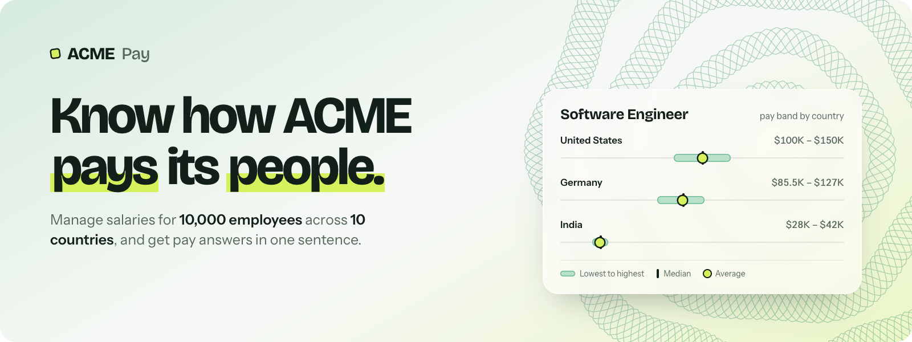
  </picture>
</a>

<a href="https://salary-management-seven-xi.vercel.app">
  
</a>

<p>
  
  
  
  
  
  
  
  
</p>

<p>
  <a href="https://salary-management-seven-xi.vercel.app"><b>🌐&nbsp;&nbsp;Live demo</b></a>
  &nbsp;&nbsp;·&nbsp;&nbsp;
  <a href="docs/REQUIREMENTS.md"><b>📋&nbsp;&nbsp;Requirements</b></a>
  &nbsp;&nbsp;·&nbsp;&nbsp;
  <a href="docs/ARCHITECTURE.md"><b>📐&nbsp;&nbsp;Architecture</b></a>
  &nbsp;&nbsp;·&nbsp;&nbsp;
  <a href="docs/AI_USAGE.md"><b>🤖&nbsp;&nbsp;How AI was used</b></a>
</p>

<br>

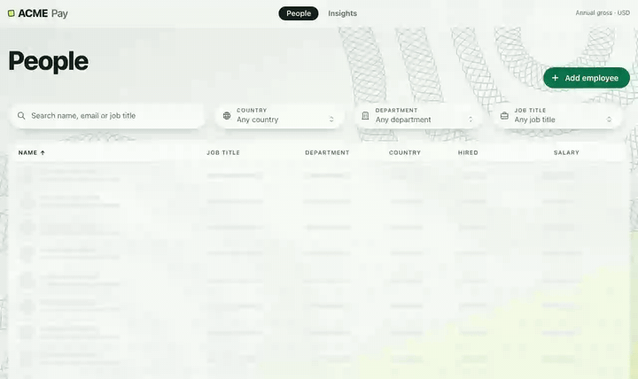

<sub>✨ <i>Search, sort by salary, edit one in place (it saves instantly), then ask "how do we pay people in India?" and watch the pay bands re-draw.</i></sub>

</div>

<br>


## 🤔 &nbsp;Why this exists

> ACME's HR team runs salaries for **10,000 people in 10 countries** out of spreadsheets.
> Every pay question means a new pivot table. **This app makes the answer the first thing you see.**

The HR Manager gets two places to work:

- 👥 &nbsp;**People.** &nbsp;Find anyone in 10,000 rows in a keystroke, fix a salary by clicking it, add or remove people.
- 📊 &nbsp;**Insights.** &nbsp;A sentence that answers the question ("In India, ACME pays **1,926 people $57.1M** a year"), backed by pay bands for every country, department and job title.

<table>
  <tr>
    <th align="left">The question HR asks</th>
    <th align="left">Where the answer is</th>
  </tr>
  <tr>
    <td>How many people do we pay, and what does that cost?</td>
    <td><b>Insights</b>: the headline sentence, with the total annual payroll</td>
  </tr>
  <tr>
    <td>What are the lowest, median, average and highest salaries in a country?</td>
    <td><b>Insights</b> → break down by <i>Country</i>: one pay band per country</td>
  </tr>
  <tr>
    <td>What does a given job earn in a given country?</td>
    <td><b>Insights</b> → pick the country: the bands switch to <i>Job title</i></td>
  </tr>
  <tr>
    <td>How does pay compare across departments?</td>
    <td><b>Insights</b> → break down by <i>Department</i></td>
  </tr>
  <tr>
    <td>What does this person earn, and can I fix it?</td>
    <td><b>People</b>: search, then click the salary and type</td>
  </tr>
</table>

<br>


## 📸 &nbsp;Gallery

<table>
  <tr>
    <td align="center" width="50%">
      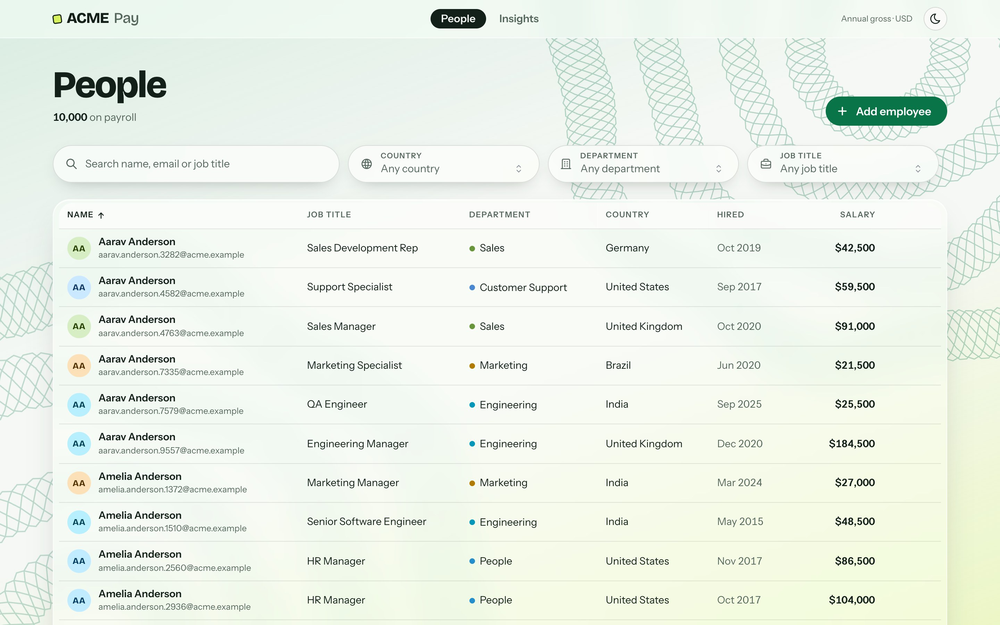<br>
      <sub>👥&nbsp; <b>People</b>: 10,000 rows, paged, sortable, searchable</sub>
    </td>
    <td align="center" width="50%">
      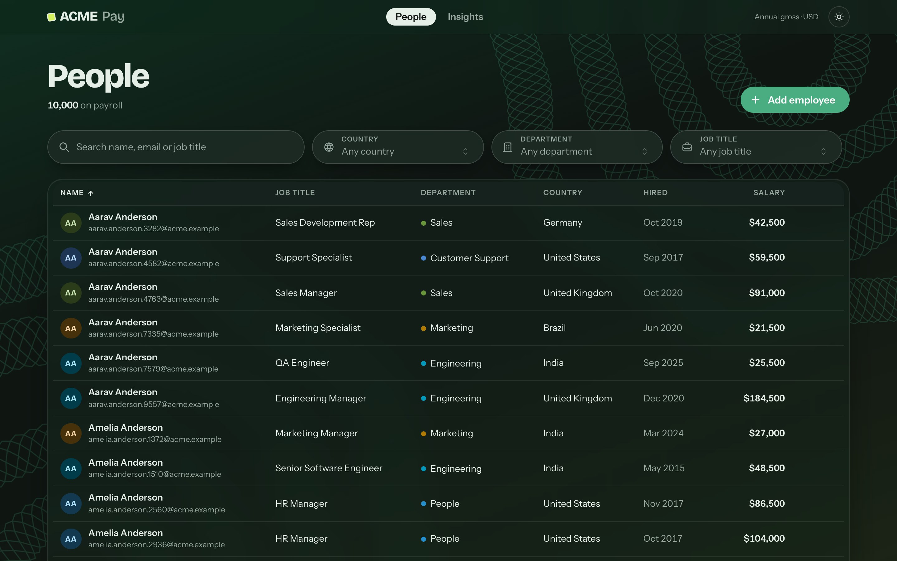<br>
      <sub>🌙&nbsp; <b>Dark mode</b>: its own theme, not an inversion</sub>
    </td>
  </tr>
  <tr>
    <td align="center">
      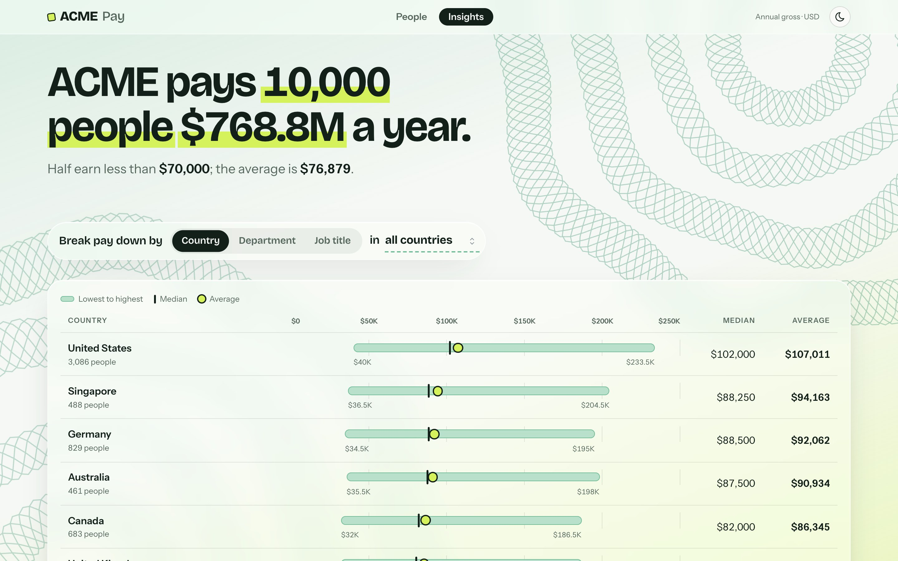<br>
      <sub>📊&nbsp; <b>Insights</b>: the answer first, then a pay band per country</sub>
    </td>
    <td align="center">
      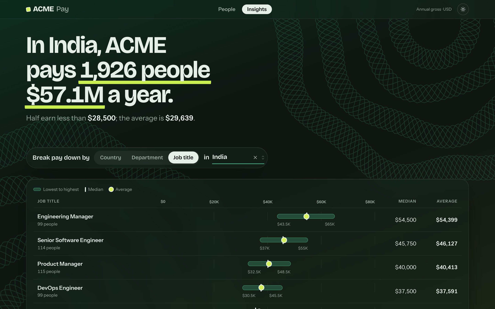<br>
      <sub>🇮🇳&nbsp; <b>One country, every role</b>: what each job earns in India</sub>
    </td>
  </tr>
  <tr>
    <td align="center">
      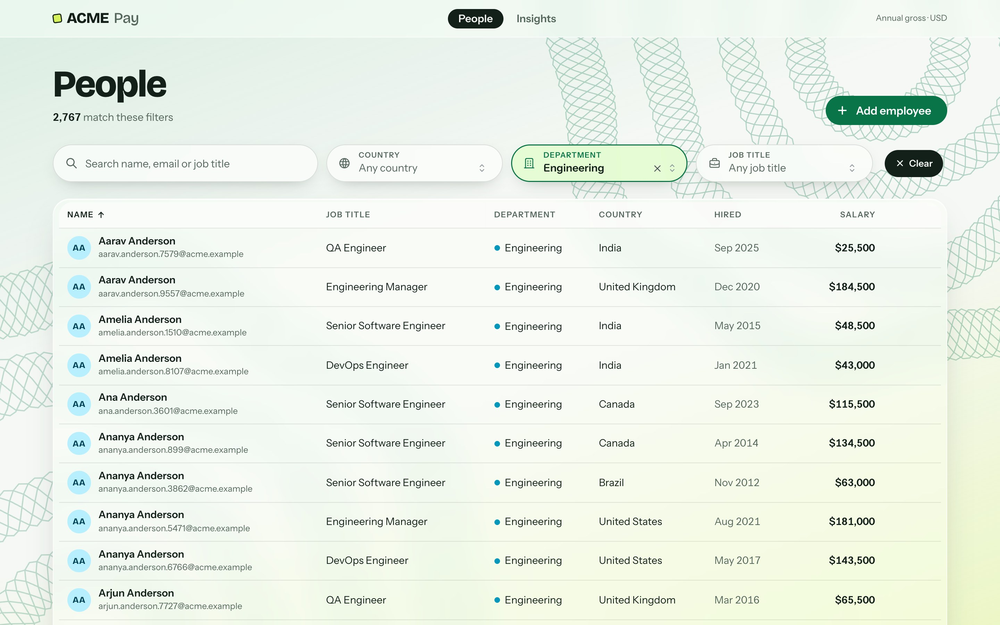<br>
      <sub>🎛️&nbsp; <b>Filter tiles</b>: a filter you've set is easy to spot</sub>
    </td>
    <td align="center">
      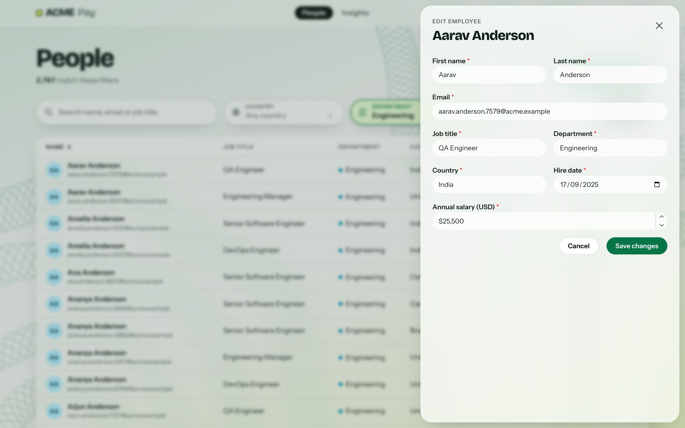<br>
      <sub>✏️&nbsp; <b>Side-panel editing</b>: the list stays in view behind frosted glass</sub>
    </td>
  </tr>
</table>

<table>
  <tr>
    <td align="center" width="25%">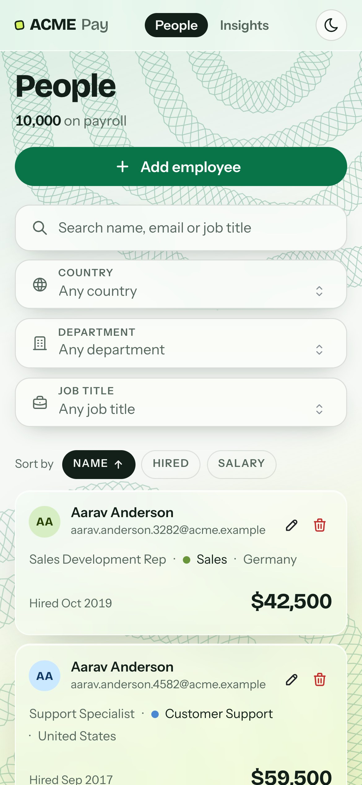</td>
    <td align="center" width="25%">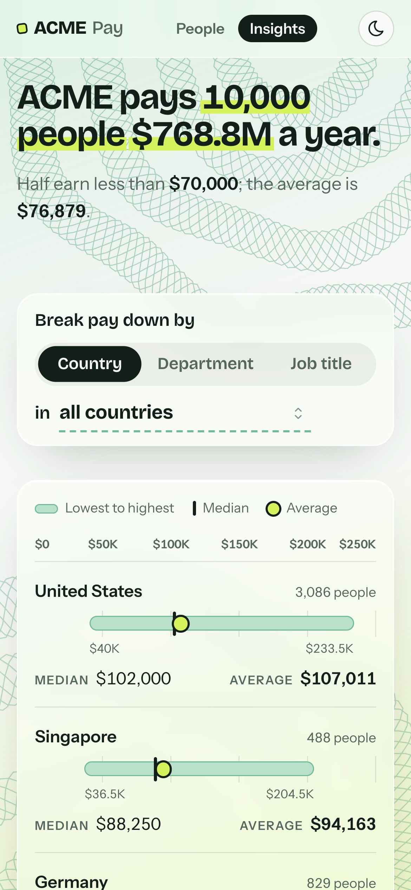</td>
    <td align="center" width="25%">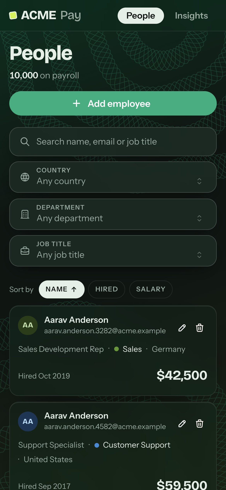</td>
    <td align="center" width="25%">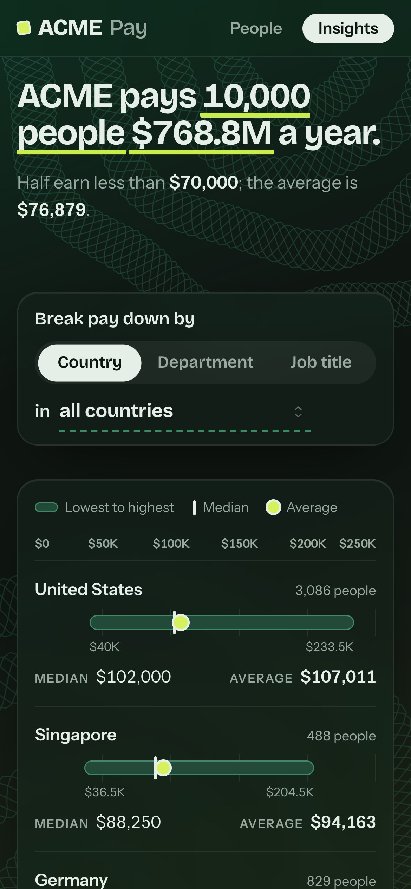</td>
  </tr>
  <tr>
    <td align="center" colspan="4"><sub>📱&nbsp; <b>On a phone</b>: each person and each pay band becomes a card. No sideways scrolling at 375px.</sub></td>
  </tr>
</table>

<br>


## ✨ &nbsp;Feature highlights

<table>
  <tr>
    <td width="33%" valign="top">
      <h3>🗣️ &nbsp;Answers, not charts</h3>
      <p>Insights opens with a plain sentence. The numbers count to their new values when you change the filter, and the key figures get a highlighter.</p>
    </td>
    <td width="33%" valign="top">
      <h3>📏 &nbsp;Pay bands</h3>
      <p>Each row shows the full range on a shared scale: lowest to highest, a tick at the median and a dot at the average. When you switch filters, the bands slide into place (View Transitions).</p>
    </td>
    <td width="33%" valign="top">
      <h3>⚡ &nbsp;Click-to-edit salaries</h3>
      <p>Click a salary, type, press Enter. It saves instantly and the row flashes. If the server rejects the change, the old value comes back with a clear error.</p>
    </td>
  </tr>
  <tr>
    <td valign="top">
      <h3>🔎 &nbsp;Search 10k people</h3>
      <p>Search by name, email or title as you type, filter by country, department or job title, and sort by name, hire date or salary. All of it runs on the server and is paged, so the browser never holds 10,000 rows.</p>
    </td>
    <td valign="top">
      <h3>🛡️ &nbsp;Validation both sides</h3>
      <p>The form checks your input before it's sent, and the model enforces the same rules on the server. Server errors, like a duplicate email, appear under the field they belong to.</p>
    </td>
    <td valign="top">
      <h3>🪟 &nbsp;Glass + guilloché</h3>
      <p>Frosted surfaces sit over an engraved guilloché pattern, the security print on pay cheques. A ☀️/🌙 toggle switches between separately tuned light and dark themes and remembers your choice. There's a solid fallback when blur isn't supported.</p>
    </td>
  </tr>
  <tr>
    <td valign="top">
      <h3>📱 &nbsp;Responsive</h3>
      <p>Tables turn into cards and the filters stack into tiles at least 48px tall, easy to tap.</p>
    </td>
    <td valign="top">
      <h3>♿ &nbsp;Accessible</h3>
      <p>Labelled controls, <code>aria-sort</code> on sortable columns, a focus trap and focus return in the side panel, and visible focus everywhere. Reduced motion and reduced transparency are both respected.</p>
    </td>
    <td valign="top">
      <h3>🚀 &nbsp;Fast</h3>
      <p>Every endpoint answers in 5–20 ms on 10k rows. Pay stats are computed in SQL, and the medians for every group come from one window-function query.</p>
    </td>
  </tr>
</table>

<br>


## 🧰 &nbsp;Tech stack

<div align="center">
  <picture>
    <source media="(prefers-color-scheme: dark)" srcset="https://skillicons.dev/icons?i=ruby%2Crails%2Csqlite%2Creact%2Cts%2Cvite%2Cnodejs%2Cdocker%2Cvercel&theme=dark&perline=9">
    
  </picture>
</div>

<br>

<table>
  <tr>
    <th></th><th align="left">Technology</th><th align="left">What it does here</th>
  </tr>
  <tr><td colspan="3"><b>⚙️ &nbsp;Backend</b></td></tr>
  <tr>
    <td align="center"></td>
    <td><b>Rails 8.1</b> (API mode)</td>
    <td>JSON API with thin controllers; the rules live in <code>EmployeesQuery</code> and <code>SalaryStats</code></td>
  </tr>
  <tr>
    <td align="center"></td>
    <td><b>Ruby 3.3</b></td>
    <td>Language for the API, the seeder and the specs</td>
  </tr>
  <tr>
    <td align="center"></td>
    <td><b>SQLite</b></td>
    <td>10k employees, indexed for the list and stats queries; medians computed with window functions</td>
  </tr>
  <tr>
    <td align="center"></td>
    <td><b>Puma</b></td>
    <td>Web server: serves <code>/api</code> and the built UI from one process</td>
  </tr>
  <tr><td colspan="3"><b>🎨 &nbsp;Frontend</b></td></tr>
  <tr>
    <td align="center"></td>
    <td><b>React 19</b></td>
    <td>UI: the People and Insights pages, side panel, click-to-edit salaries</td>
  </tr>
  <tr>
    <td align="center"></td>
    <td><b>TypeScript 7</b></td>
    <td>Typed API client and components</td>
  </tr>
  <tr>
    <td align="center"></td>
    <td><b>Mantine 9</b></td>
    <td>Accessible inputs, popovers and notifications, themed to pine and chartreuse, with light/dark switching</td>
  </tr>
  <tr>
    <td align="center"></td>
    <td><b>Vite</b></td>
    <td>Dev server (proxies <code>/api</code>) and production build</td>
  </tr>
  <tr><td colspan="3"><b>🧪 &nbsp;Quality</b></td></tr>
  <tr>
    <td align="center">💎</td>
    <td><b>RSpec</b></td>
    <td>51 backend specs: model, query, stats, seeder and request specs</td>
  </tr>
  <tr>
    <td align="center"></td>
    <td><b>Vitest</b> +  <b>Testing Library</b></td>
    <td>30 frontend tests, run in jsdom</td>
  </tr>
  <tr>
    <td align="center"></td>
    <td><b>RuboCop</b> · <b>oxlint</b></td>
    <td>Lint Ruby (Rails Omakase) and TypeScript</td>
  </tr>
  <tr><td colspan="3"><b>🚢 &nbsp;Ship</b></td></tr>
  <tr>
    <td align="center"></td>
    <td><b>Docker</b></td>
    <td>One image: Vite build + Rails + a pre-seeded database</td>
  </tr>
  <tr>
    <td align="center"></td>
    <td><b>Vercel</b></td>
    <td>Runs the image on its Container Runtime: <a href="https://salary-management-seven-xi.vercel.app">salary-management-seven-xi.vercel.app</a></td>
  </tr>
  <tr>
    <td align="center">🎭</td>
    <td><b>Playwright</b> +  <b>ffmpeg</b></td>
    <td>Generate this README's animated banner (frame-stepped CSS → WebP), screenshots and demo GIF (<code>docs/assets/src/capture.mjs</code>)</td>
  </tr>
</table>

<br>


## 📐 &nbsp;Architecture

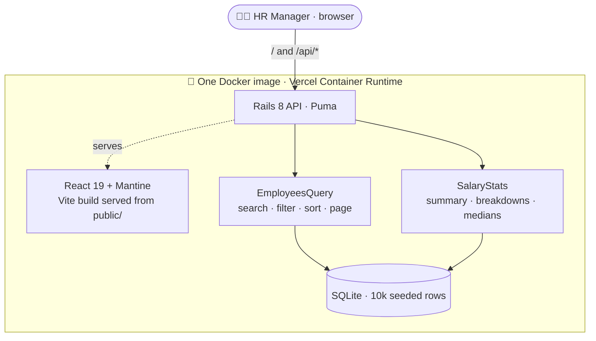

Full write-up, including the API reference, trade-offs, performance notes and next steps: **[docs/ARCHITECTURE.md](docs/ARCHITECTURE.md)**

<br>


## 🚀 &nbsp;Quick start

Needs Ruby 3.3.10, Node 24 and SQLite.

```bash
git clone https://github.com/shivani2001-art/salary-management.git && cd salary-management
```

```bash
cd backend && bundle install && bin/rails db:prepare && bin/rails server   # API on :3000, seeds 10k employees
```

```bash
cd frontend && npm install && npm run dev                                  # UI on :5173, proxies /api to :3000
```

| Command | What it does |
|---|---|
| `bin/rails db:prepare` | 🌱 &nbsp;Create, migrate and seed 10,000 employees (~1.5 s; the same data every time) |
| `bin/rails db:seed:replant` | ♻️ &nbsp;Wipe and reseed. `SEED_COUNT=500` for a smaller set |
| `bundle exec rspec` | 🧪 &nbsp;Backend specs |
| `npm test` | 🧪 &nbsp;Frontend tests (Vitest + Testing Library) |
| `bin/rubocop` · `npm run lint` | 🧹 &nbsp;Lint Ruby and TypeScript |
| `API_URL=http://localhost:3100 npm run dev` | 🔌 &nbsp;Point the dev UI at an API on another port |

<br>


## 🧪 &nbsp;Tests

<table>
  <tr>
    <th align="left">Suite</th><th align="right">Tests</th><th align="left">Covers</th>
  </tr>
  <tr>
    <td>💎 &nbsp;<b>RSpec</b></td><td align="right"><b>51</b></td>
    <td>Model validation and normalization · search, filter, sort and paging · stats (odd/even medians, scoping, rejected group names) · seeder (same data every run, valid rows) · request specs for every endpoint (404, 422, 400)</td>
  </tr>
  <tr>
    <td>⚛️ &nbsp;<b>Vitest</b></td><td align="right"><b>30</b></td>
    <td>API client (query strings, field errors) · formatting · employee form (validation, server errors) · click-to-edit salary (Enter, Esc, invalid input) · pay band geometry · counting numbers under reduced motion · theme toggle</td>
  </tr>
</table>

Both suites run in about a second and don't touch the network.

<br>


## ☁️ &nbsp;Deploy

**Live:** **https://salary-management-seven-xi.vercel.app** &nbsp;·&nbsp; Vercel Container Runtime

The root `Dockerfile` builds the UI with Vite, puts it in Rails' `public/` folder, and bakes the seeded database into the image, so a cold start doesn't have to seed. The Vercel project uses the `container` framework preset with `PORT=3000`.

```bash
vercel deploy --prod
```

> [!NOTE]
> Vercel instances have no persistent disk. Edits on the live demo last only as long as an instance runs, and separate instances don't share them. That's fine for a demo. For real data, point Active Record at hosted Postgres (for example Neon from the Vercel Marketplace). It's a `database.yml` change; the only SQL that isn't plain Active Record is the median query, and it's standard SQL.

<details>
<summary><b>🐳 &nbsp;Run the same image anywhere</b></summary>

<br>

```bash
docker build -t acme-salary .
```

```bash
docker run -p 3000:3000 -e FORCE_SSL=false acme-salary   # http://localhost:3000
```

Behind a host that handles TLS for you, leave `FORCE_SSL` unset. [`render.yaml`](render.yaml) is a ready-made Render Blueprint; mount a volume at `/rails/storage` there to keep edits.

</details>

<br>


## 🗂️ &nbsp;Project map

<details>
<summary><b>Where things live</b></summary>

<br>

```text
backend/
  app/models/employee.rb            validation + normalization: the data contract
  app/queries/employees_query.rb    search, filter, sort and paging from untrusted params
  app/services/salary_stats.rb      all the pay maths, over any slice of employees
  app/services/employee_seeder.rb   generates the 10k seed rows (same data every run)
  app/controllers/api/              thin HTTP layer
frontend/src/
  components/EmployeesPage.tsx      list, filter tiles, click-to-edit, side panel
  components/InsightsPage.tsx       headline sentence + question controls
  components/PayBands.tsx           the signature visual
  glass.css · styles.css · theme.ts design tokens, glass layer, Mantine theme
  assets/guilloche.svg              generated by scripts/guilloche.mjs
docs/
  REQUIREMENTS.md · ARCHITECTURE.md · AI_USAGE.md
  assets/src/capture.mjs            regenerates every image in this README
```

</details>

| Artifact | What it shows |
|---|---|
| 📋 &nbsp;[Requirements](docs/REQUIREMENTS.md) | One page, written before any code: goal, scope, and what's deliberately left out |
| 📐 &nbsp;[Architecture](docs/ARCHITECTURE.md) | Diagram, API, decisions and trade-offs, performance, what's next |
| 🤖 &nbsp;[AI usage](docs/AI_USAGE.md) | How AI tools were used, and what was corrected along the way |
| 🎨 &nbsp;[Design context](.impeccable.md) | Audience, personality, palette and the design principles behind the UI |
| 🎬 &nbsp;Video demo | _Add link_ |

<br>

<div align="center">

<sub>Built for the ACME HR team · Rails 8 · React 19 · deployed on Vercel</sub>


</div>
