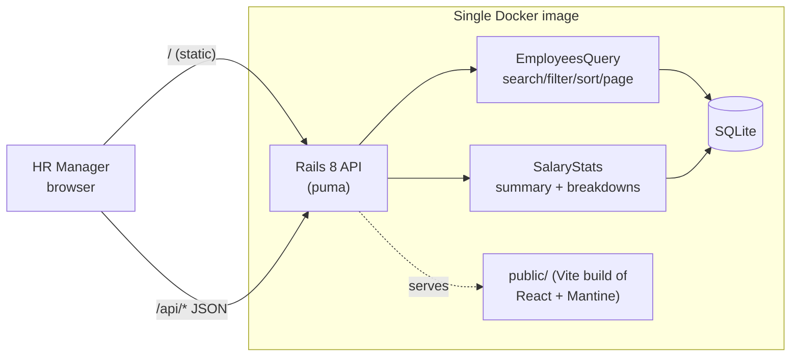

# Architecture, decisions and trade-offs

## Shape



```
backend/
  app/models/employee.rb          validations + normalization (the data contract)
  app/queries/employees_query.rb  list filtering/sorting/pagination from untrusted params
  app/services/salary_stats.rb    all "how do we pay people" maths, over any scope
  app/services/employee_seeder.rb deterministic 10k-row generator
  app/controllers/api/*           thin HTTP layer: params in, JSON out
frontend/src/
  api.ts                          typed client, ApiError with field errors
  components/EmployeesPage.tsx    list + filters + CRUD modals
  components/InsightsPage.tsx     summary cards + breakdown table
  components/EmployeeForm.tsx     shared create/edit form
```

## API

| Method | Path | Notes |
|---|---|---|
| GET | `/api/employees` | `q`, `country`, `department`, `job_title`, `sort` (`name`/`salary`/`hire_date`), `direction`, `page`, `per_page` (≤100) → `{ data, meta }` |
| GET | `/api/employees/:id` | |
| POST | `/api/employees` | `{ employee: {...} }` → 201, or 422 `{ errors: { field: [msg] } }` |
| PATCH | `/api/employees/:id` | same shape as POST |
| DELETE | `/api/employees/:id` | 204 |
| GET | `/api/employees/filter_options` | distinct countries / departments / job titles present in data |
| GET | `/api/insights/summary` | headcount, total payroll, average, median; accepts the same filters |
| GET | `/api/insights/breakdown?group_by=country\|department\|job_title` | per-group headcount, min, max, avg, median; accepts filters |

"Average salary for job title X in country Y" = `breakdown?group_by=job_title&country=Y`. The same
filter vocabulary works on every endpoint, so the UI composes questions rather than needing an endpoint per question.

## Key decisions

| Decision | Why | Trade-off accepted |
|---|---|---|
| **Rails API + React SPA in one container** | One deploy, same origin (no CORS, no auth cookie headaches later). Vite proxies `/api` in dev to mirror prod. | Frontend and backend release together. Fine at this size. |
| **SQLite** | Allowed by the brief, zero-ops, more than fast enough for 10k rows (all endpoints 5–20 ms in production mode). | Single writer, local disk. Moving to Postgres is a `database.yml` change; the only SQLite-specific SQL is the median window query, which is standard SQL. |
| **Salary as integer whole USD** | Avoids float rounding in sums/averages; whole dollars is how salaries are discussed. | No cents, single currency (see requirements doc). |
| **Aggregates in SQL, not Ruby** | `GROUP BY` + `MIN/MAX/AVG/COUNT` is one query; medians use `ROW_NUMBER() OVER (PARTITION BY …)` so a breakdown costs 2 queries regardless of group count. | Slightly denser SQL, so it's isolated in one service with focused tests. |
| **Query object + service, thin controllers** | The business rules (filtering, stats) are unit-tested without HTTP; controllers just translate. | Two extra files vs. fat controllers. |
| **Allow-lists at the boundary** | `group_by` and `sort` are checked against constants before touching SQL; filters go through `permit` so only scalars reach `where`; `LIKE` wildcards are escaped. | — |
| **Server-side pagination (25/page)** | 10k rows in the browser is slow and wasteful. | Each page/filter change is a round trip (debounced 300 ms for search). |
| **Filter options derived from data** | No hard-coded country list to keep in sync. New country = just add an employee. | Typos create new values; Autocomplete in the form nudges toward existing ones. |
| **Mantine** | Accessible components (labels, aria on progress bars, keyboard nav) and dark mode for free. | ~550 kB JS bundle (gzip ~170 kB). Acceptable for an internal tool; could code-split per tab. |
| **No charting library** | Inline progress bars in the table answer "who is paid more" without another dependency. | Less visual than real charts. |
| **Deterministic seed (`Random.new(42)`)** | Reproducible demos and tests; country weights + pay multipliers make insights realistic. | — |

## Performance notes (10k employees)

- Seeding: `insert_all` in 1 000-row batches → ~0.6–1.5 s for 10k rows.
- Indexes match the access paths: `email` (unique), `(country, job_title)`, `department`, `(last_name, first_name)`.
- Measured in production mode on a laptop: list with filter + sort ≈ 10 ms, search ≈ 7 ms,
  summary ≈ 6 ms, country breakdown ≈ 17 ms.
- `LIKE '%term%'` search can't use an index; it's a scan of 10k rows and stays fast. At ~1M rows
  switch to SQLite FTS5 or Postgres trigram indexes.
- Counting for pagination is one extra `COUNT(*)` per list request. Fine here; keyset pagination would
  be the upgrade path for much larger tables.

## What I'd do next (in order)

1. **Authentication + roles** (HR admin vs. read-only), before any real data.
2. **Salary history** (`salary_changes` table with effective dates and who/why), which also enables an audit log.
3. **CSV/Excel import & export**, the migration path off spreadsheets.
4. **Multi-currency**: store local currency + amount, normalize via a dated FX table for org-wide stats.
5. Pay-equity views (e.g. spread within the same title & country, outliers), which build on the same `SalaryStats`.
